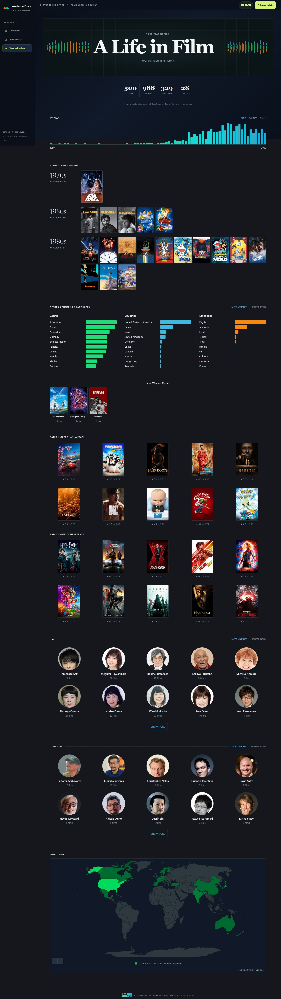

# 🎬 Letterboxed Stats

[](LICENSE)
[](https://www.typescriptlang.org/)
[](https://react.dev/)
[](https://vite.dev/)
[](https://workers.cloudflare.com/)
[](https://developer.themoviedb.org/)
[](#deployment)

**A free, independent film-stats project inspired by Letterboxd Pro’s All-Time Stats and Year in Review.**

Import a Letterboxd data export to explore your watched films, ratings, viewing history, and yearly recaps. This is a personal passion project with no financial incentive. It is not affiliated with, endorsed by, or sponsored by Letterboxd or TMDB.

> “Letterboxd” is a trademark of its respective owner. This project is unofficial and is not a replacement for every Letterboxd feature.

## Year in Review



## What it does

- Imports a Letterboxd ZIP export and reads its watched, diary, and ratings data.
- Automatically matches eligible films with TMDB to add posters, release information, genres, countries, directors, cast, runtimes, and TMDB community scores.
- Shows a progress bar, elapsed time, and estimated time remaining while enrichment runs. Films with ambiguous matches are left for manual review.
- Keeps watched and rated films in the film library, with search, sorting, and filters for genre, director, country, and rating.
- Builds yearly and all-time recaps with activity charts, rating comparisons, decade highlights, rewatches, genre/country/language summaries, cast and director rankings, and a zoomable country map.
- Saves the imported library in the browser’s IndexedDB so it can be restored on that device.

### Dates and ratings

Viewing dates come from the diary’s **Watched Date** field. If there is no dated diary viewing for a film, the app falls back to the date in `watched.csv`. Ratings come from `ratings.csv`, so rating a film later does not move its viewing into the year it was rated.

### Movie matching

TMDB matching uses the film title and release year with a confidence check. When candidates are too close or the year/title does not match confidently, the film is left for manual review instead of being silently assigned the wrong metadata. The app is for films; TV shows and series, including anime series, are outside the movie stats. Anime feature films are still films and can be imported normally.

## Getting started

### Requirements

- Node.js 22 or newer
- npm

### Run locally

```bash
git clone https://github.com/mdshies008/Film-Wrapped.git
cd Film-Wrapped
npm ci
npm run dev
```

Open the local URL printed by Vite. In the app, choose **Import data** and select the ZIP downloaded from Letterboxd’s data export page.

### Build and lint

```bash
npm run lint
npm run build
npm run preview
```

The production build is written to `dist/`.

## Built with

- React and TypeScript
- Vite
- JSZip and Papa Parse for reading export files
- TMDB API for movie metadata and images
- Cloudflare Workers for the TMDB proxy
- GitHub Actions and GitHub Pages for deployment

## Credits and attribution

Movie data and images are provided by [The Movie Database (TMDB)](https://www.themoviedb.org/). This product uses the TMDB API but is not endorsed or certified by TMDB. TMDB’s logo and attribution notice are included in the app as required for API use.

Letterboxd export data belongs to the account holder and is processed locally by this project. This project is not affiliated with or endorsed by Letterboxd.

## Project status

This is a non-commercial, community-shared passion project made for personal use and friends. It is free to use and has no financial incentive behind it. Metadata matching depends on TMDB’s catalog and may require manual review for unusual titles, alternate releases, or title/year mismatches.
